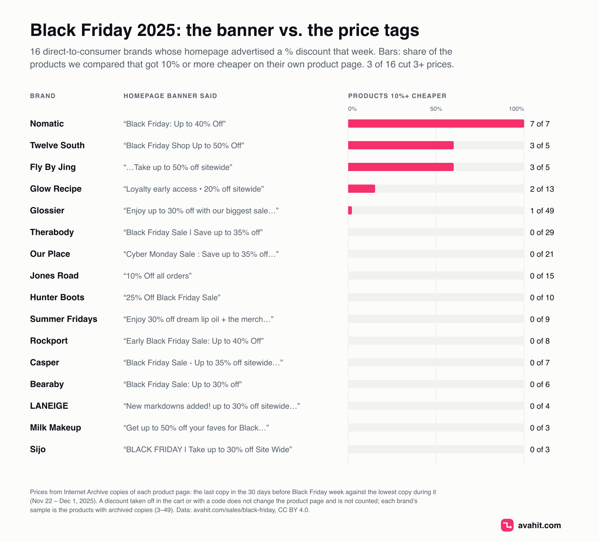

# Black Friday 2025: homepage banners vs. product-page prices

Did the product-page price actually drop at direct-to-consumer brands that advertised
"up to 30% off" for Black Friday 2025? This dataset compares Internet Archive copies
of 336 product pages at 102 direct-to-consumer brand stores (prices in USD), from the 30 days before Black Friday
week with the week itself (November 22 to December 1, 2025, through Cyber Monday).
It also includes 150 archived copies of the stores' homepage banners from that week.

## Findings

Counted at the 36 stores where at least three products could be compared (319 products):

- 21 of 319 products (7%) were 10% or more cheaper during Black Friday week than just before it.
- 19 of the 36 stores advertised a discount on the homepage banner, typically "up to 30% off".
  At 16 of those 19, fewer than three of the compared products got cheaper on the product page.
- Only 3 stores cut the price of three or more products: Nomatic (7 of 7, median −20%),
  Fly By Jing (3 of 5, −25%) and Twelve South (3 of 5, −30%).
- Therabody's banner said "Save up to 35% off", and 0 of 29 product pages showed a lower price.
  Glossier's said "Enjoy up to 30% off with our biggest sale of the year!": 1 of 49.

If the product page kept its regular price, the discount was applied in the cart, with a
code, or to products outside the sample. It could still be a real saving, but the shopper
only saw it at checkout, measured against a "was" price the store chose.

The same numbers, store by store, are at <https://avahit.com/sales/black-friday>.

## Method

- **Baseline:** October 23 – November 21, 2025. **Black Friday week:** November 22 – December 1, 2025.
- **Price before** is the last archived price in the baseline. **Week low** is the lowest archived
  price during the week. A product counts as cheaper if the week low is at least 10% below the price before.
- **Below 30-day low:** the week low is more than 1% below the lowest baseline price. This
  separates a real discount from a price that was raised in October and "cut" in November.
- A product is compared only if the Internet Archive saved its page at least once in both periods.
  Prices under $3 (samples, minis) are excluded. All prices are in USD, as shown on the product page.
- **Banner offers:** sale lines from archived homepage copies during the week, up to three per
  store, most frequent first. `banner_max_pct_off` is the largest "N% off" among them.
- Stores with fewer than three compared products are listed only if their banner said something
  (`in_summary = false`). The findings above count only `in_summary = true` stores.

Every price links to the Wayback Machine copy it was read from (`*_snapshot` columns).

## Files

**stores.csv**: one row per store (102 rows)

| column | meaning |
|---|---|
| `store_domain` | store website |
| `brand` | brand name |
| `avahit_url` | store page with daily price checks since 2026 |
| `products_compared` | products archived in both periods |
| `products_cheaper_10pct` | of them, 10% or more cheaper during the week |
| `median_cut_pct` | median cut among the cheaper products, % |
| `homepage_banner_offers` | sale lines from the homepage banner that week, separated by ` \| ` |
| `banner_max_pct_off` | largest "N% off" in the banner |
| `in_summary` | `true` if three or more products were compared |

**products.csv**: one row per compared product (336 rows)

| column | meaning |
|---|---|
| `store_domain`, `brand`, `product` | store, brand, product name |
| `avahit_url` | product page with its current price history |
| `currency` | always USD |
| `price_before`, `price_before_date`, `price_before_snapshot` | last baseline price, its date and archive copy |
| `lowest_price_30d_before` | lowest baseline price |
| `lowest_price_bf_week`, `lowest_price_bf_week_date`, `lowest_price_bf_week_snapshot` | lowest price during the week, its date and archive copy |
| `change_pct` | week low against price before, % (negative = cheaper) |
| `cheaper_10pct` | `true` if `change_pct` ≤ −10 |
| `below_30d_low` | `true` if cheaper and also below the 30-day low |

**banners.csv**: one row per archived homepage copy (150 rows from 86 stores)

| column | meaning |
|---|---|
| `store_domain` | store website |
| `captured_at` | archive capture time, UTC |
| `text` | banner text as captured, one sentence per line |
| `snapshot_url` | Wayback Machine copy |

## Limitations

- Samples are small: 1 to 49 products per store (3 to 49 among the 36 stores in the findings), and only products the archive happened to save in
  both periods. The archive does not pick products at random, so bestsellers are likely overrepresented.
- Cart-level discounts, codes and gift-with-purchase offers do not change the product page and are not counted.
- A cut shorter than the gap between two archive copies can be missed.

## Black Friday 2026

This year the prices are not taken from archive copies. Avahit checks these brands' product pages
every day and keeps each product's lowest price of the last 30 days. From October 22, 2026 that
window covers the 30 days before Black Friday week: <https://avahit.com/sales/black-friday#prices-to-beat>.

## License and citation

CC BY 4.0. Quote it or reuse it with a link to the source:

> Avahit (2026). *Black Friday 2025: homepage banners vs. product-page prices.* https://avahit.com/sales/black-friday
